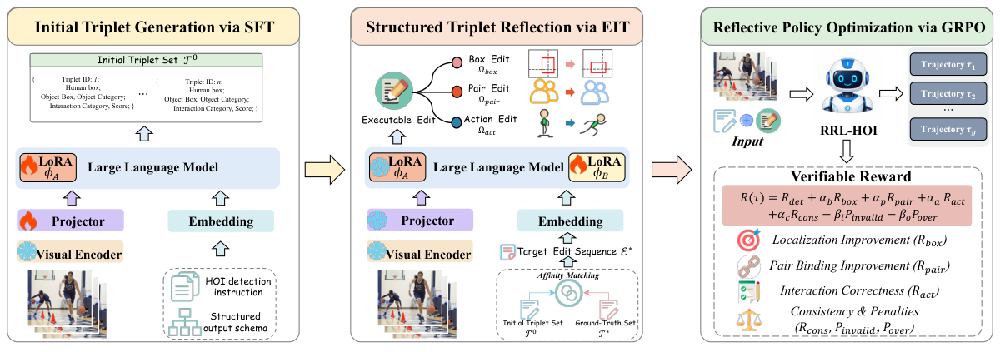

# RRL-HOI: Reflective Reinforcement Learning for Open-Vocabulary HOI Detection

Official repository for **RRL-HOI: Reflective Reinforcement Learning for Open-Vocabulary HOI Detection**.

## Code Release

**Code coming soon.** Training and evaluation code will be released in this repository.

## Overview

RRL-HOI turns open-vocabulary human-object interaction (HOI) detection into an explicit **verify-and-revise** process. It addresses language-prior hallucinations and coupled localization-semantic errors by learning executable edits over box-grounded HOI predictions.

The framework consists of three stages:

- **Initial Triplet Generation via Supervised Fine-Tuning (SFT):** adapts an MLLM to generate structured HOI triplets containing human and object boxes, object categories, interaction verbs, and confidence scores.
- **Structured Triplet Reflection via Edit Instruction Tuning (EIT):** learns to revise initial predictions through executable box adjustments, human-object pair rebinding, and interaction-semantic edits.
- **Reflective Policy Optimization via GRPO:** optimizes the reflection policy with verifiable rewards for detection quality, localization improvement, pair-association correctness, interaction correctness, and edit consistency, while penalizing invalid outputs and unnecessary edits.

At inference time, RRL-HOI generates an initial triplet set, predicts a structured edit sequence, and applies the edits to obtain the final HOI predictions. The framework uses lightweight LoRA adapters while keeping the base MLLM frozen, without relying on external detector proposals.

## Benchmarks

RRL-HOI is evaluated on **HICO-DET** and **SWIG-HOI**, using **Qwen3-VL-8B** as the default backbone and **Qwen2.5-VL-7B** to evaluate generality across MLLM backbones.

## Acknowledgments

Our work builds on the Qwen-VL family of multimodal models and Group Relative Policy Optimization (GRPO). We thank the creators of HICO-DET and SWIG-HOI for providing the evaluation benchmarks.
